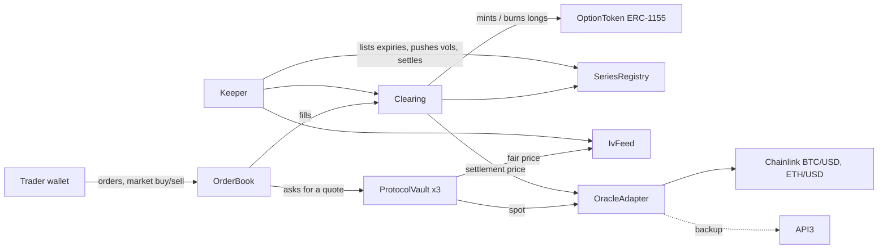

<div align="center">

# Derstar

**On-chain options exchange on Arbitrum**

Order book · Protocol vaults · Cash settlement · Weekly BTC and ETH options

[](https://github.com/derstarteam-a11y/derstar-contracts/actions/workflows/ci.yml)


[App](https://derstar.xyz) · [Docs](https://derstar.gitbook.io/derstar-docs) · [Brand kit](https://derstar.xyz/brand/) · [X](https://x.com/Derstar_options) · [Discord](https://discord.gg/yAawhGKQxP)

</div>

---

## What Derstar is

Derstar is a fully on-chain options exchange. Every order, trade, position and payout lives in
these contracts on Arbitrum; there is no off-chain matching engine and no custody.

- **European BTC and ETH options**, calls and puts, cash-settled.
- **Weekly expiries** every Friday at 08:00 UTC, plus month-end expiries.
- **Central limit order book** with price-time priority. Makers can also quote in implied
  volatility: the order is repriced with Black-Scholes from live spot at every match.
- **Protocol vaults** quote both sides from a fair Black-Scholes price plus a spread, so there is
  liquidity from the first day. A vault fills only when it beats the best resting order.
- **Fully collateralised.** Calls are collateralised and paid out in the underlying (WBTC, WETH),
  puts in USDC. Leftover collateral goes straight back to the writer's wallet at expiry.

## How it works



1. The keeper lists the coming Fridays with a strike grid around spot and publishes an
   implied-volatility smile per expiry.
2. Traders place limit orders or take liquidity. One Sell button both closes a long and writes a
   new option against collateral; one Buy button covers a short first.
3. Trading stops 30 minutes before expiry. The settlement price is a 30-minute TWAP walked from
   Chainlink rounds, with an API3 backup if Chainlink stops updating.
4. Anyone can call settlement: holders are paid the intrinsic value, writers get the rest of their
   collateral back. Every step is permissionless and idempotent.

## Deployed contracts (Arbitrum Sepolia)

Closed testnet, deployed 31 Oct 2026 (block 324535483).

| Contract | Address | Role |
|---|---|---|
| SeriesRegistry | [`0xbDABDF3Dbd83E231286d567E545c773425bb21CD`](https://sepolia.arbiscan.io/address/0xbDABDF3Dbd83E231286d567E545c773425bb21CD) | Underlyings, weekly calendar, strike grid, trading cutoff |
| Clearing | [`0x0c3C57c8981Fbe8988d6019d124E30c419081e62`](https://sepolia.arbiscan.io/address/0x0c3C57c8981Fbe8988d6019d124E30c419081e62) | Balances, collateral, fills, fees, settlement and payouts |
| OrderBook | [`0x4807dd5c730A01ef4219A9F62a1DB09E503484E1`](https://sepolia.arbiscan.io/address/0x4807dd5c730A01ef4219A9F62a1DB09E503484E1) | Limit and vol orders, price-time priority, market buy/sell |
| OptionToken | [`0xfc4F18c5acbb3e498a831D0195696f18CE2F04F2`](https://sepolia.arbiscan.io/address/0xfc4F18c5acbb3e498a831D0195696f18CE2F04F2) | ERC-1155 long positions (id = series id) |
| OracleAdapter | [`0xf00271f4629E85548f0865A559D349D0F01D8300`](https://sepolia.arbiscan.io/address/0xf00271f4629E85548f0865A559D349D0F01D8300) | Chainlink spot, 30-min settlement TWAP, API3 backup |
| IvFeed | [`0x7BD0B5d7C9cB28Dd18bD61A8f8204A2df92263C4`](https://sepolia.arbiscan.io/address/0x7BD0B5d7C9cB28Dd18bD61A8f8204A2df92263C4) | Implied-vol smile per expiry |
| ProtocolVault (BTC calls) | [`0xC3177Fd93BA57240A06006B94DF039c92322FeB8`](https://sepolia.arbiscan.io/address/0xC3177Fd93BA57240A06006B94DF039c92322FeB8) | Quotes BTC calls, collateral tWBTC |
| ProtocolVault (ETH calls) | [`0x1e2414Dde5A28BC5D2Cc29001cccA110FFbfb7Ad`](https://sepolia.arbiscan.io/address/0x1e2414Dde5A28BC5D2Cc29001cccA110FFbfb7Ad) | Quotes ETH calls, collateral tWETH |
| ProtocolVault (puts) | [`0xab893f9Ff88bAe6856ae703a199aDB246842d3e4`](https://sepolia.arbiscan.io/address/0xab893f9Ff88bAe6856ae703a199aDB246842d3e4) | Quotes BTC and ETH puts, collateral tUSDC |
| tUSDC / tWBTC / tWETH | [`0x965e5368c8E75A23E3E1eD6e80a47B78874d6b9c`](https://sepolia.arbiscan.io/address/0x965e5368c8E75A23E3E1eD6e80a47B78874d6b9c) [`0xd1eb2997F5bdFbe1Fe734C329A725811adEfd2b6`](https://sepolia.arbiscan.io/address/0xd1eb2997F5bdFbe1Fe734C329A725811adEfd2b6) [`0x6018c44D38e4b540da8c0791Ea2e1E298b8FB522`](https://sepolia.arbiscan.io/address/0x6018c44D38e4b540da8c0791Ea2e1E298b8FB522) | Test tokens with a daily faucet |
| TestnetAccess | [`0x1376dBB6479208096eDB7d92CC12c434977EfC96`](https://sepolia.arbiscan.io/address/0x1376dBB6479208096eDB7d92CC12c434977EfC96) | Invite list for the closed testnet faucets |

Price feeds: Chainlink BTC/USD [`0x56a43EB56Da12C0dc1D972ACb089c06a5dEF8e69`](https://sepolia.arbiscan.io/address/0x56a43EB56Da12C0dc1D972ACb089c06a5dEF8e69), ETH/USD [`0xd30e2101a97dcbAeBCBC04F14C3f624E67A35165`](https://sepolia.arbiscan.io/address/0xd30e2101a97dcbAeBCBC04F14C3f624E67A35165).

## Fees

| | |
|---|---|
| Taker | 0.03% of notional, capped at 12.5% of premium |
| Maker | 0.015% of notional, capped at 12.5% of premium |
| Settlement | 0.015% of notional per side at expiry |

Notional is Chainlink spot × contracts.

## Safety

- **144 tests**, including fuzzing and an invariant suite that runs thousands of random orders,
  trades, cancels and transfers and checks that Clearing stays exactly solvent and that
  `totalSupply == totalShort` for every series.
- Price inputs are checked for staleness and for the Arbitrum sequencer being down; the vaults
  stop quoting when spot or volatility is stale.
- Governance for mainnet: every admin role moves to a 48-hour Timelock run by the team Safe
  (`script/HandoffGovernance.s.sol`); the deployer keeps no role.
- **Not audited yet.** This is a testnet. Do not use these contracts with real funds.

## Repository

```
src/core/        Clearing, OrderBook, SeriesRegistry, OptionToken, OracleAdapter, IvFeed, ProtocolVault, FeeCollector
src/libraries/   BlackScholes (on-chain, ~18k gas), ExpiryCalendar, TickBitmap, SeriesId
src/interfaces/  External interfaces
src/mocks/       Test tokens, mock feeds, TestnetAccess
test/            Foundry tests, fuzz and invariants
script/          Testnet deploy and admin scripts, mainnet governance handoff
deployments/     Deployed addresses per chain
```

## Build and test

Requires Node 22 and [Foundry](https://getfoundry.sh).

```bash
npm install
forge build
forge test
```

## Units

- Sizes in lots: 1 BTC lot = 0.01 contract, 1 ETH lot = 0.1 contract.
- Prices in ticks per contract: BTC tick = 5 USDC, ETH tick = 0.5 USDC.
- Series id packs `[underlying:8 | optType:8 | expiry:64 | strike:64]`.

## License

Copyright © 2026 Derstar. All rights reserved. The source is published for transparency and
review; see [LICENSE](LICENSE).

Security issues: write to derstar.team@gmail.com.
